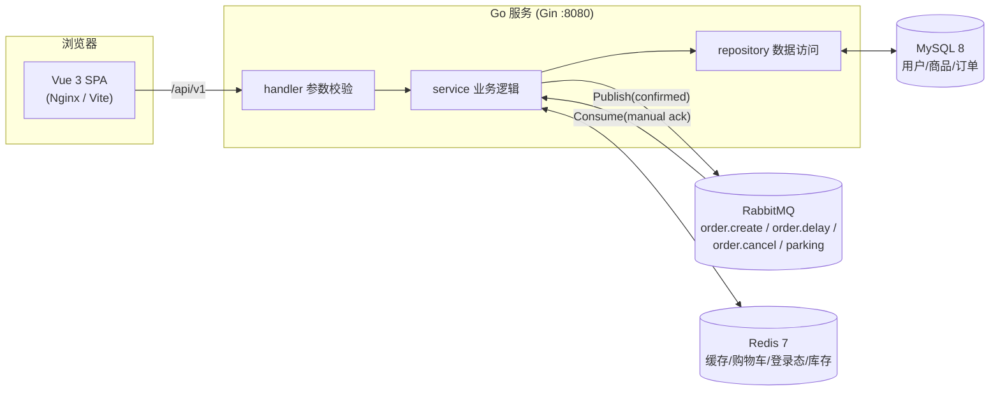

# 小鹿童装商城(Fawn Mall)

面向 0-12 岁儿童(婴幼儿 0-3 / 小童 3-6 / 中童 6-9 / 大童 9-12)的全栈在线童装商城。
商品按「款式 + 尺码(90-160)」双维度管理库存,支持购物车、下单、模拟支付、超时自动取消、
管理后台(商品 / 分类 / 订单 / 用户)。

## 技术栈

| 层 | 技术 |
| --- | --- |
| 后端 | Go 1.22 · Gin · GORM · golang-jwt/v5 · go-redis/v9 · amqp091-go |
| 前端 | Vue 3(`<script setup>` 组合式 API)· TypeScript · Vite · Pinia · Vue Router · Element Plus(**原生 fetch 封装,未用 axios**) |
| 存储 | MySQL 8(业务数据)· Redis 7(商品缓存 / 购物车 / 登录态 / 库存预扣) |
| 消息 | RabbitMQ 3.13(订单异步落库 + 延迟取消,confirm + manual ack + 重试) |
| 工具链 | docker-compose 一键基础设施 · go-task(Taskfile.yml)· GitHub Actions |

## 架构



```
┌──────────┐   /api/v1    ┌─────────────────────────────────────────┐
│ Vue SPA  │ ───────────► │ Go(Gin)                                 │
│  :5173/  │ ◄─────────── │  handler → service → repository          │
└──────────┘  {code,msg,  │      │            │            │         │
                  data}   │      ▼            ▼            ▼         │
                         │ ┌─────────┐ ┌──────────┐ ┌──────────┐     │
                         │ │ Redis   │ │ RabbitMQ │ │ MySQL    │     │
                         │ │ ·商品缓存│ │ ·异步下单 │ │ ·用户/商品│     │
                         │ │ ·购物车  │ │ ·延迟取消 │ │ ·订单     │     │
                         │ │ ·登录态 │ │  (DLX)   │ │ (最终一致)│     │
                         │ │ ·库存   │ └──────────┘ └──────────┘     │
                         │ └─────────┘                                │
                         └─────────────────────────────────────────┘
```

## 目录结构

```
tz-mall/
├── docker-compose.yml        # MySQL/Redis/RabbitMQ + server + web 一键编排
├── Taskfile.yml              # go-task:dev / infra / server:dev / web:dev / test ...
├── .github/workflows/
│   ├── ci.yml                # 后端(真实三件套服务容器)+ 前端 CI
│   └── cd.yml                # 镜像构建推送 ghcr.io + 可选 SSH 部署
├── server/                   # Go 后端
│   ├── cmd/server/main.go    # 入口:配置→迁移→种子→MQ→HTTP→优雅退出
│   ├── config/config.yaml    # 默认配置(生产用 TZ_* 环境变量覆盖)
│   └── internal/
│       ├── handler/          # 路由 + 参数绑定校验 + 统一响应
│       ├── service/          # 业务逻辑(下单/支付/取消/金额计算...)
│       ├── repository/       # MySQL(GORM)/ Redis / 缓存访问
│       ├── mq/               # RabbitMQ 客户端:拓扑/confirm/manual ack/重连
│       ├── model/            # GORM 模型(User/Category/Product/SKU/Order...)
│       ├── middleware/       # JWT 鉴权 + 角色校验 + CORS + 日志
│       └── seed/             # 幂等种子数据(7 分类 / 26 商品 / 测试账号)
└── web/                      # Vue 3 前端
    └── src/
        ├── api/              # 原生 fetch 封装 + 全部接口定义
        ├── stores/           # Pinia(user / cart)
        ├── router/           # 路由 + 登录守卫 + 管理端布局
        └── views/            # 首页/详情/购物车/结算/订单/登录 + admin/*
```

## 快速启动

### 前置要求

- Docker + docker compose
- Go 1.22+(跑后端开发与测试)
- Node 20+(前端开发)
- [go-task](https://taskfile.dev)(可选,没有也可直接看 Taskfile.yml 里的原始命令)

### 方式一:全容器(推荐体验完整链路)

```bash
docker compose up -d --build
# 首次构建较慢;启动完成:
#   前端      http://localhost:8090
#   后端      http://localhost:8080/healthz
#   RabbitMQ  http://localhost:15673  (fawn / fawn_dev_123)
```

### 方式二:本地开发(基础设施容器 + 本地进程)

```bash
cp .env.example .env        # 按需修改口令
task infra                  # 只起 MySQL/Redis/RabbitMQ 容器
task server:dev             # 后端 :8080(热重启可自行配 air)
task web:dev                # 前端 :5173,/api 代理到 8080
```

或使用一条命令:`task dev`(起基础设施后在后台拉起前后端)。

### 端口说明(重要)

本机 3306/6379/5672 可能被其他项目占用,因此 **宿主机端口做了重映射**,
容器网络内部仍是标准端口:

| 服务 | 宿主机端口 | 容器内端口 | 环境变量覆盖 |
| --- | --- | --- | --- |
| MySQL | **3316** | 3306 | `TZ_MYSQL_PORT` |
| Redis | **6381** | 6379 | `TZ_REDIS_ADDR` |
| RabbitMQ | **5673** / 15673 | 5672 / 15672 | `TZ_RABBITMQ_URL` |
| Go 后端 | 8080 | 8080 | `TZ_SERVER_PORT` |
| 前端 dev / 容器 | 5173 / 8090 | 5173 / 80 | — |

所有连接参数都收敛在 `TZ_*` 环境变量(见 `server/pkg/config/config.go`),
本地跑测试时 `testutil` 默认使用上表宿主机端口,CI 中覆盖为标准端口。

### 测试账号(种子数据)

| 账号 | 密码 | 角色 |
| --- | --- | --- |
| `admin` | `admin123` | 管理员(可进 `/admin`) |
| `demo` | `demo123` | 普通用户 |

种子数据:7 个分类、26 个商品,覆盖全部 4 个年龄段,每件商品 ≥3 个尺码,
图片为 picsum.photos 占位图。

## 核心设计

### 1. 防超卖:Redis Lua 预扣 → MQ 异步 → MySQL 条件更新

超卖的经典成因是「多进程同时读到同一份库存再各自扣减」。本项目三段式防护:

1. **Redis Lua 原子预扣(第一道闸)**:下单接口先执行 Lua 脚本,
   「校验全部条目库存充足后一次性扣减」,任一尺码不足则整单拒绝、全部回滚。
   脚本内 key 不存在按 0 处理,防止未初始化商品被下单。
   压测:200 并发抢 50 件库存,恰好 50 单成功(`cachestock_test.go`)。
2. **MQ 异步落库(削峰)**:预扣成功即返回订单号,订单由消费者写入 MySQL。
   消息启用 **publisher confirm**;消费端 **manual ack** + 幂等(订单号唯一索引),
   处理失败按 `x-retry` 头重试,超过 3 次进入 parking 队列人工排查。
3. **MySQL 条件更新(最终兜底)**:落库执行
   `UPDATE skus SET stock = stock - ? WHERE id = ? AND stock >= ?`,
   影响行数为 0 即视为库存不足 → 订单落库为已取消并回补 Redis;
   即使 Redis 与 MySQL 短暂不一致也不会卖超。

并发验证:10 个订单并发抢 5 件库存,MySQL 成功落库恰 5 单(`order_cancel_test.go`)。

### 2. 超时未支付自动取消:RabbitMQ TTL + 死信交换机

不引入定时轮询,用消息自身 TTL 实现延迟:

```
下单成功(待支付) ──► fawn.order.delay (x-message-ttl=900s, 无消费者)
                            │ 消息过期
                            ▼ x-dead-letter-exchange → fawn.order.cancel
                       消费者:15 分钟到点,校验仍未支付
                            │
              ┌─── 条件更新 status: pending_payment → canceled
              │    (WHERE order_no=? AND status='pending_payment',与支付接口互斥)
              ├─── MySQL 库存回补(条件 UPDATE,同方向防重复)
              └─── Redis 库存回补(重试 3 次)
```

「支付 vs 超时取消」的竞态由 **条件更新** 保证:两个操作都以
`WHERE status = 'pending_payment'` 为前提,数据库行锁下恰好一方成功。
压测:100 个 goroutine 对同一订单并发 pay/cancel,恰好 1 个成功。
注:延迟队列参数(x-message-ttl)在队列声明时固定,调整超时需删除
`fawn.order.delay` 队列后重启服务。

### 3. 用户管理:封禁与角色调整的「即时生效」

JWT 无状态,签发后无法撤销——管理员封禁某用户后,其手中的 token 最长还能再用 72 小时,
这是不可接受的。管理端的用户操作因此分两步落地:

1. **MySQL 落库**(权威状态):`users.status`(1 正常 / 0 禁用)与 `users.role`,
   登录时校验,被禁账号直接拒绝。
2. **Redis 覆盖键**(存量 token 即时生效):
   - `fawn:udis:{userID}`:存在即拒绝该用户的一切请求(封禁);
   - `fawn:urole:{userID}`:角色覆盖值,优先于 token 内角色(升降权)。
   鉴权中间件逐请求校验这两个键;TTL 与 token 有效期一致,自然过期后新 token 携带最新状态。

降权场景验证:demo 以管理员身份登录 → 管理端将其降为普通用户 →
**同一个 token** 再调管理接口立即返回 40301。

管理端用户功能:列表(用户名模糊 / 角色 / 状态筛选 + 分页)、封禁/解封、
角色调整(升级/取消管理员)、重置密码;后端强制「不能封禁/降权自己」,
被封禁用户的存量登录态立即失效。

### 4. 缓存策略

- 商品详情 / 首页聚合:cache-aside,详情 TTL 30 分钟、首页 TTL 10 分钟;
  管理端改商品 / 改库存时 **主动 DEL** 对应缓存键,读时回源重建。
- 库存:key `fawn:stock:{productID}:{size}`,服务启动用 **SETNX** 从 MySQL 同步
  (不覆盖在途预扣);管理员直接改 SKU 库存时强制覆盖 + 失效商品缓存。
- 登录态:JWT 无状态 + 登出黑名单(Redis,TTL = token 剩余有效期);
  管理端封禁 / 角色调整另用 `fawn:udis:{uid}` / `fawn:urole:{uid}` 覆盖键,
  对已签发的存量 token 即时生效(见「用户管理」一节)。
- 购物车:Redis Hash,field 为 `{productID}:{size}` —— 同款不同尺码是两个条目。

## API 一览(前缀 `/api/v1`)

| 方法 | 路径 | 说明 | 鉴权 |
| --- | --- | --- | --- |
| POST | `/auth/register` | 注册(用户名+密码,bcrypt 存储) | - |
| POST | `/auth/login` | 登录,返回 JWT | - |
| POST | `/auth/logout` | 登出(token 进黑名单) | 用户 |
| GET | `/user/me` | 当前用户信息(含角色) | 用户 |
| GET | `/home` | 首页聚合(推荐 + 分类) | - |
| GET | `/categories` | 分类列表 | - |
| GET | `/products` | 商品列表:分页 / 分类 / 年龄段 / 关键词 | - |
| GET | `/products/:id` | 商品详情(含各尺码库存;走 Redis 缓存) | - |
| GET | `/cart` | 购物车(条目 + 合计) | 用户 |
| POST | `/cart/items` | 加购(product_id + size + quantity) | 用户 |
| PUT | `/cart/items/:field` | 改数量 / 勾选状态 | 用户 |
| DELETE | `/cart/items/:field` | 删除条目 | 用户 |
| PUT | `/cart/select-all` | 全选 / 取消全选 | 用户 |
| POST | `/orders` | 下单(Redis 预扣 + MQ 异步落库) | 用户 |
| GET | `/orders` | 我的订单(状态筛选 + 分页) | 用户 |
| GET | `/orders/:orderNo` | 订单详情 | 用户 |
| POST | `/orders/:orderNo/pay` | 模拟支付 | 用户 |
| POST | `/orders/:orderNo/cancel` | 主动取消(未支付,回补库存) | 用户 |
| POST | `/orders/:orderNo/confirm` | 确认收货 | 用户 |
| GET | `/admin/me` | 管理员信息 | 管理员 |
| GET/POST | `/admin/products` | 商品列表 / 新增 | 管理员 |
| PUT/DELETE | `/admin/products/:id` | 编辑(含 SKU 尺码)/ 删除 | 管理员 |
| PUT | `/admin/skus/:id` | 直接改某尺码库存(同步 MySQL+Redis) | 管理员 |
| GET/POST | `/admin/categories` | 分类列表 / 新增 | 管理员 |
| PUT/DELETE | `/admin/categories/:id` | 编辑 / 删除 | 管理员 |
| GET | `/admin/orders` | 全量订单(状态筛选 + 分页) | 管理员 |
| PUT | `/admin/orders/:orderNo/ship` | 发货 | 管理员 |
| GET | `/admin/users` | 用户列表(用户名模糊 / 角色 / 状态筛选 + 分页) | 管理员 |
| PUT | `/admin/users/:id/status` | 封禁 / 解封(存量 token 即时失效) | 管理员 |
| PUT | `/admin/users/:id/role` | 调整角色(升级 / 取消管理员,即时生效) | 管理员 |
| PUT | `/admin/users/:id/password` | 重置密码 | 管理员 |

统一响应 `{ code, msg, data }`。错误码:`0` 成功;
`40001` 参数错误、`40101` 未登录、`40301` 无权限、`40401` 不存在、`50001` 服务端错误;
`60001-60015` 业务错误(用户名已存在 / 库存不足 / 订单状态冲突 / 账号已被禁用等,见 `server/pkg/resp/resp.go`)。

## CI / CD

### CI(`.github/workflows/ci.yml`)—— 真实依赖,禁止 mock

- **backend job**:GitHub Actions 服务容器拉起真实 **MySQL 8 / Redis 7 / RabbitMQ 3.13**
  (与 docker-compose 同版本),端口与口令经 `TZ_*` 环境变量注入测试。
  依次执行 `gofmt` 检查 → `go vet` → `go build` → `go test -p 1 -count=1 ./...`
  (覆盖库存 Lua 并发预扣、订单金额计算、超时取消回补、MySQL 条件更新防超卖、
  TTL+DLX 延迟链路端到端)。`-p 1` 串行避免测试共享中间件时互踩。
- **frontend job**:Node 20,`npm ci` → `vue-tsc --noEmit` → `npm run build`。
- 任一 job 失败即 CI 失败。

### CD(`.github/workflows/cd.yml`)—— 镜像构建 + 可选部署

- 触发:push 到 `main` 或打 `v*.*.*` 标签。
- 后端多阶段 Dockerfile(`golang:1.22-alpine` 编译 `CGO_ENABLED=0` 静态二进制 →
  `alpine:3.20` 非 root 运行);前端多阶段 Dockerfile(node 构建 → `nginx:1.27-alpine`,
  Nginx 托管 SPA 并将 `/api` 反代到后端容器)。
- 镜像推送 `ghcr.io`:分支名 + `sha-xxxxxxx`;tag 发布时额外推
  `1.2.3` / `1.2` / `latest` 语义化版本。凭据仅用内置 `GITHUB_TOKEN`,仓库零明文密钥。
- `deploy` job 默认 `if: false` 禁用;启用时在仓库 Secrets 配置
  `SSH_HOST` / `SSH_USER` / `SSH_KEY` 后删除该行即可。

## 本地测试

```bash
task infra        # 先起真实中间件(测试禁止 mock 依赖)
task server:test  # gofmt 检查 + go vet + go test -p 1 -count=1 ./...
task web:typecheck
task web:build
```

测试要点:

| 测试 | 覆盖 |
| --- | --- |
| `cachestock_test` | Lua 批量原子扣减:200 并发抢 50 件恰成功 50;部分不足整单回滚;回补;SETNX 不覆盖在途预扣 |
| `order_calc_test` | 订单金额纯函数(价格快照、数量、溢出防护)+ 订单号格式 |
| `order_cancel_test` | 超时取消双端(MySQL+Redis)回补且幂等;100 并发 pay/cancel 恰 1 成功;10 单抢 5 件 MySQL 不超卖 |
| `admin_user_test` | 用户列表筛选;封禁/解封的 DB+Redis 双端一致与登录拒绝;角色覆盖;重置密码;自我保护规则 |
| `delay_test` | 真实 RabbitMQ TTL(1s)+ DLX 死信转发端到端 |

## 自测清单

- [x] 注册 → 登录 → 浏览商品(分页/分类/年龄段/关键词筛选)→ 加购 → 下单 → 支付 → 管理端发货 → 确认收货,全链路可用
- [x] 未支付 15 分钟自动取消,MySQL 与 Redis 库存同时回补(开发期用 3s TTL 验证后恢复 900s)
- [x] 并发下单不超卖:Redis Lua 200 并发 / 50 库存恰成功 50;MySQL 条件更新 10 单抢 5 件恰成功 5
- [x] 商品详情命中 Redis 缓存(第二次请求走缓存,后台日志可见;修改商品后缓存失效重建)
- [x] `vue-tsc --noEmit` 与 `npm run build` 通过;`go vet` / `gofmt` / `go test ./...` 全绿
- [x] 登出后 token 立即失效(黑名单);非管理员访问管理接口返回 40301
- [x] 管理端用户管理:封禁后登录被拒且存量 token 即时失效;降权管理员同 token 即时失去管理权限;不能封禁/降权自己

## 常用 Task

```
task dev          # 基础设施 + 后台拉起前后端
task infra        # 仅 MySQL/Redis/RabbitMQ
task server:dev   # 后端 :8080
task web:dev      # 前端 :5173
task server:test  # 后端全套检查 + 测试
task web:build    # 前端类型检查 + 生产构建
task up / down    # 全容器起 / 停
task logs         # 跟踪容器日志
```
